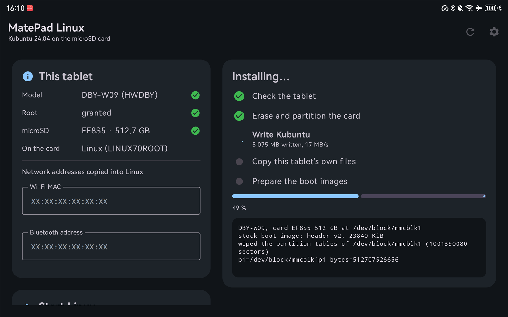

# MatePad Linux installer

HarmonyOS app for the Huawei MatePad 11 (DBY-W09) that installs Kubuntu
24.04 on the microSD card and switches the tablet into it. HarmonyOS, its
partitions on the internal storage and its data stay as they are; only the
three boot partitions are rewritten when Linux is started, and Kubuntu's
**Restart to HarmonyOS** writes the stock ones back.



| Repository | Role |
| --- | --- |
| [linux-dby-w09](https://github.com/svesnav/linux-dby-w09) | kernel, device tree, boot bundle |
| [kubuntu-dby-w09](https://github.com/svesnav/kubuntu-dby-w09) | Kubuntu image and hardware services |
| **dby-w09-installer** (this one) | the HarmonyOS app |

## Requirements

- MatePad 11 (DBY-W09) on HarmonyOS, rooted (APatch, Magisk or KernelSU)
- a microSD card of 32 GB or more (16 GB minimum); it is erased completely
- for a GitHub download: a network connection
- for the M-Pencil in Linux: the pen paired in HarmonyOS once (the app takes
  its address from there)

## Using it

1. Install the APK and open **MatePad Linux**; allow it root (APatch: add it in the Superuser list; Magisk: accept the prompt).
2. *This tablet* shows the model, the card and the Wi-Fi and Bluetooth
   addresses that Linux will use. Enter the Bluetooth address by hand if
   HarmonyOS does not report it (Settings › About tablet › Status).
3. *Your Kubuntu*: your name, user name, password, computer name, language,
   keyboard layout, time zone, and whether to log in automatically (on by
   default: the login screen has no on-screen keyboard yet).
4. *Install Linux*: pick a GitHub release or a local `.img.xz` / `.img.gz`,
   then **Erase card and install**.
5. **Boot Linux** restarts into Kubuntu, straight to its login screen.
6. M-Pencil: in Kubuntu, take the pen off its magnet and put it back once.
   Linux pairs it by itself in the background (it does not show up in
   Bluetooth settings' device search); from then on it connects like in
   HarmonyOS.

## What the installation does

| Step | Details |
| --- | --- |
| Check the tablet | root, model, card; reads the stock `boot` and `ramdisk` partitions |
| Erase and partition the card | clears both partition-table areas, writes an MBR with one Linux partition from 4 MiB to the end |
| Write Kubuntu | streams the release (resuming dropped connections) through the xz/gzip decoder straight to the partition; checks the SHA-256 of the download |
| Copy this tablet's own files | mounts the new root and copies the vendor files and firmware the image lists (`/usr/share/matepad/device-files`), the Wi-Fi/Bluetooth addresses, the paired M-Pencil's address (Linux pairs the pen by it), and the stock `boot`/`ramdisk`/`dtbo` images for Restart to HarmonyOS |
| Set up your account and language | in the new root (chroot): creates the user with the password (passed over stdin only), computer name, time zone, locale and keyboard layouts (the on-screen keyboard gets the same languages), optional automatic login (SDDM), then switches Kubuntu's own first-boot setup off |
| Prepare the boot images | from the image's boot bundle and the stock partitions: `boot` (stock header and ramdisk, Linux kernel, DTB with this tablet's Bluetooth address, command line), `ramdisk` (Linux initramfs over the stock partition, AVB footer kept), `dtbo`; staged in `/cache/linux70` with `SHA256SUMS` |

**Boot Linux** runs `/cache/linux70/boot-linux.sh`: it checks the staged
images, writes them, reads them back and restarts. The same script works from
a root shell: `su -c sh /cache/linux70/boot-linux.sh`.

## Updating

**Update** (shown when the card already has Kubuntu from this app) updates it
in place, keeping your files, settings and apps: in a chroot it runs
`apt-get update` and `full-upgrade` against Ubuntu and the MatePad apt
repository ([kubuntu-dby-w09](https://github.com/svesnav/kubuntu-dby-w09)
`packaging/`), then rebuilds the boot images from the updated kernel; **Boot
Linux** starts it. A card from before the MatePad packages first gets the
repository and moves its hand-installed support over to the packages.

The Linux filesystem grows to the whole card on its first boot. No Huawei
file is downloaded: everything Huawei comes from the tablet it is installed on.

## Building

GitHub Actions (`.github/workflows/build.yml`) runs the unit tests and builds
the APK on every push (artifact `apk`); a `v*` tag publishes it as a release.
Locally, with the Android SDK and Gradle 8.11:

```bash
gradle testDebugUnitTest assembleRelease
```

## Layout

| Path | Contents |
| --- | --- |
| `app/src/main/java/org/matepad/installer/core/` | boot image (mkbootimg v0–v2), DTB, MBR and ramdisk helpers; plain Java with unit tests |
| `app/src/main/java/org/matepad/installer/` | Compose UI, view model, installation steps, GitHub download, `su` helper |
| `app/src/main/assets/matepad.sh` | the root-side steps (probe, card, populate, update) |
| `app/src/main/assets/boot-linux.sh` | the same script as kubuntu-dby-w09 `boot-switch/boot-linux.sh` |
| `signing/` | the shared signing key |
